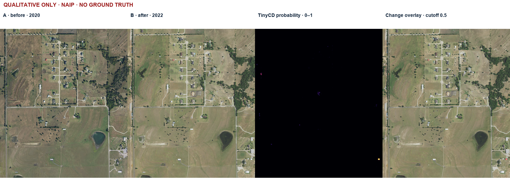

# ASTRA

A local research app that maps new buildings between two satellite images with a pretrained TinyCD model, scored against fixed baselines on a held-out benchmark and checked under misalignment and blur.

Built with AI coding agents (Claude, Codex); tests and verification by me.



Qualitative side demo on public-domain USDA NAIP imagery (Celina, Texas; 2020-11-02 and 2022-07-04; 0.6 m). There are no ground-truth labels for this pair, so it is not a score.

## Results

Held-out LEVIR-CD test set, 128 image pairs; the model was not tuned on these pairs.

| Check | Result | Source |
|---|---|---|
| Pretrained TinyCD, pixel level | Precision 0.9266, recall 0.8953, F1 0.9107, IoU 0.8360 | `outputs/benchmark_test.csv` |
| OpenCV baselines, pixel level | F1 0.1306 (basic) and 0.1003 (improved) | `outputs/benchmark_test.csv` |
| TinyCD, object level | Completeness 0.957 against 0.071 for a chance baseline (predictions paired with a different image, seed 42), giving an object skill of 0.953 | `outputs/object_null_completeness_seed42.csv` (summed over size bins) |
| Input shifted by 5 px in x and y, fixed 32-pair subset | F1 fell from 0.9211 (control) to 0.7229 | `outputs/robustness_test_seed42.csv` |
| False alarms on LEVIR, objects ≥ 5 m² | 7.48 false-alarm objects per km² | `outputs/isolated_object_summary.csv` |
| Same 128 test pairs on Apple MPS and on CPU | Identical true-positive, false-positive and false-negative pixel counts | `outputs/tinycd_test_mps_comparison.csv` |
| Model size | The pretrained TinyCD model has 285,128 parameters (the model's own count, not parameters trained for ASTRA) | `PROVENANCE.md` |
| Test suite | 48 passed with the original TinyCD installed. With the same Python dependencies and no local checkpoint or upstream model code, 47 passed and the TinyCD smoke test was skipped | `tests/` |

## Registration

On the 128 LEVIR-CD test pairs, shifting the second image by (+5, +5) px reduced pixel F1 to 0.7293. Automatic translation correction recovered it to 0.7917. On inputs with no injected shift, enabling correction reduced F1 from 0.9117 to 0.8994. All conditions used the same valid image area within each pair and shift. The app therefore opens with correction off. [outputs/registration/test_overlap_summary.csv](outputs/registration/test_overlap_summary.csv) · [registration report](docs/reports/2026-11-21-astra-registration.md)

In the follow-up comparison on common interpolation support, the subpixel DFT candidate reduced median shift error from 2.2373 to 2.2071 px at (+5, +5), but recovered less of the available F1 gain (25.44% versus 34.20%). Validation selected the original estimator. None of 24 French validation pairs met the independent reference criteria for measuring natural displacement. [outputs/generalization/reg_test_summary.csv](outputs/generalization/reg_test_summary.csv) · [validation selection](outputs/generalization/registration_choice.json) · [natural displacement survey](outputs/generalization/landmarks/result.json)

## External test on French orthophotos

The original TinyCD checkpoint was trained on LEVIR-CD. Its pixel F1 on the frozen French FOTBCD-Binary test split was **0.243 → 0.348 → 0.532** across the three configurations below. Model selection used French training and validation data. Each frozen configuration was evaluated once on the same 979 official test pairs. [test manifest](data/manifests/fotbcd/test.csv) · [frozen settings](docs/generalization-final-config.json) · [full report](docs/reports/2026-11-21-astra-generalization.md)

| Configuration | Pixel F1 (95% interval) | Recall for newly appeared buildings | Recall for disappeared buildings | Per-pair TP/FP/FN |
|---|---:|---:|---:|---|
| Original weights, native 0.2 m/px, threshold 0.5 | 0.243 (0.208–0.282) | 18.64% | 0.94% | [original/counts.csv](outputs/generalization/final/original/counts.csv) |
| Same weights, approximately 0.5 m/px, threshold 0.3 | 0.348 (0.300–0.399) | 28.28% | 3.32% | [calibrated/counts.csv](outputs/generalization/final/calibrated/counts.csv) |
| Locally fine-tuned weights, approximately 0.5 m/px, threshold 0.5 | 0.532 (0.478–0.585) | 49.52% | 6.71% | [adapted/counts.csv](outputs/generalization/final/adapted/counts.csv) |

The paired gains were +0.105 (95% interval +0.067 to +0.143) for calibration and +0.184 (+0.140 to +0.233) from calibration to fine-tuning. These descriptive percentile intervals were computed for this release from the saved counts using 10,000 paired patch-bootstrap samples, seed 42. They describe sampling variation across these patches. Spatial dependence and variation across countries or training runs lie outside their scope. [outputs/generalization/final/f1_intervals.json](outputs/generalization/final/f1_intervals.json) · [interval calculation](scripts/summarize_fotbcd_intervals.py)

Directional recall is the fraction of pixels inside each polygon class covered by a binary change prediction. All 979 pairs matched by metadata. The model missed most pixels for disappeared buildings even after fine-tuning. [outputs/generalization/final/direction.json](outputs/generalization/final/direction.json)

Fine-tuning used 1,024 French training pairs. The third epoch had the highest validation F1. On the original LEVIR-CD test, F1 went from **0.911 to 0.896**. Before inference, the independent reviewer predicted a French F1 of 0.35 (0.25–0.50) for the original checkpoint and 0.65 (0.55–0.75) after fine-tuning. Both observations fell below the corresponding forecast ranges. [train manifest](data/manifests/fotbcd/train.csv) · [training history](outputs/generalization/training.csv) · [levir_original.csv](outputs/generalization/levir_original.csv) · [levir_adapted.csv](outputs/generalization/levir_adapted.csv) · [preregistration](docs/2026-11-21-generalization-preregistration.md)

## How it was verified

- **Held-out benchmark.** Scores come from the official LEVIR-CD test split (128 pairs) with a fixed threshold. The OpenCV baselines (absolute difference with a fixed or Otsu threshold) are scored the same way.
- **A chance baseline for objects.** Object completeness is compared with a deranged null: each ground-truth image is paired with predictions from a different test image (seed 42). Object skill is (real − chance) / (1 − chance).
- **Robustness under stated conditions.** Shifts of 1, 2, 3 and 5 px (equal in x and y), gain, gamma, Gaussian blur and noise were applied to a fixed 32-pair subset (seed 42, 8 px border cropped). TinyCD's F1 was 0.9026, 0.8606, 0.8128 and 0.7229 for the four shifts, against 0.9211 without perturbation.
- **Device check.** The full test split was run on MPS and on CPU, and the confusion counts were required to match exactly.
- **Tests** cover the OpenCV detector, padding and tiling, the GSD-scaled minimum object area, input-quality warnings, GeoTIFF reading and alignment, and a Streamlit smoke test for each method on a synthetic pair.

## Limits

- Scores apply to the stated LEVIR-CD and FOTBCD-Binary splits. Recall on the French test set depends strongly on the direction of change.
- The blur sweep uses the fixed 32-pair subset. The registration study also evaluates synthetic shifts on the full LEVIR test split.
- The NAIP figure is a qualitative demonstration with no ground truth, not a scored evaluation.
- The 7.48 false-alarm objects per km² is a LEVIR benchmark yardstick, not a false-alarm rate measured on NAIP.
- TinyCD's code and checkpoint are for non-commercial and research use only (see below), which limits how the full app can be used.

## Run it

Python 3.12.

```sh
git clone https://github.com/hyh4867/astra.git
cd astra
python3.12 -m venv .venv && . .venv/bin/activate
python -m pip install -r requirements.txt
python -m pytest -q
streamlit run app.py
```

The base install supports the OpenCV methods. Tests that require missing optional ML dependencies or a local checkpoint report a skip. To run the TinyCD smoke test, install PyTorch, the pinned model code and the original checkpoint:

```sh
python -m pip install -r requirements-ml.txt
python scripts/install_tinycd.py          # TinyCD code from a pinned upstream commit, SHA-256 checked
python scripts/download_tinycd_weights.py # pretrained LEVIR-CD checkpoint -> models/ (not committed)
python -m pytest -q
```

The fine-tuned ROBUST-v2 checkpoint mentioned in the app is not published (it derives from the non-commercial TinyCD weights and LEVIR-CD), so the app offers only the original model.

To reproduce the benchmark files in `outputs/`, download LEVIR-CD with `python scripts/download_levir_benchmark.py` (val and test archives from the Hugging Face mirror; about 0.7 GB) and run `python scripts/evaluate_benchmark.py`. The robustness and object-level files come from `scripts/scientific_evaluation.py` and `scripts/final_analysis_additions.py`. These steps need the data and were not re-run for this repository. Archive hashes and split counts are recorded in `PROVENANCE.md`; the file lists for each split are in `data/manifests/`.

## Data, citation and licenses

The datasets, the TinyCD code and the checkpoint are not redistributed here.

| Item | Source | Terms |
|---|---|---|
| LEVIR-CD (637 image pairs) | Provider page <https://justchenhao.github.io/LEVIR/>; mirror used: Hugging Face `satellite-image-deep-learning/LEVIR-CD` | Academic, non-commercial use only; follow Google Earth terms. Only file names are included here (`data/manifests/`). |
| TinyCD code and LEVIR-CD checkpoint | <https://github.com/AndreaCodegoni/Tiny_model_4_CD> | Non-commercial and research purposes only; no open-source license. Downloaded by `scripts/install_tinycd.py` and `scripts/download_tinycd_weights.py`. See `vendor/tinycd/NOTICE.md`. |
| FOTBCD-Binary and full FOTBCD polygons | Abdelrrahman Moubane, [Binary release](https://huggingface.co/datasets/abdevd/FOTBCD-Binary/tree/7ebaa487d49215fdc684461ee52b41adafd83e86) and [polygon release](https://huggingface.co/datasets/abdevd/FOTBCD/tree/92b677c881f0d973d76460204431c711ccbac25b). Run [scripts/fetch_generalization.py](scripts/fetch_generalization.py) for the pinned files, then [scripts/freeze_generalization.py](scripts/freeze_generalization.py) with PyArrow installed to recreate the split lists. | Both editions use [CC BY 4.0](https://creativecommons.org/licenses/by/4.0/). Source imagery and topographic data are IGN BD ORTHO and BD TOPO under Licence Ouverte 2.0. ASTRA publishes split identifiers and derived measurements. [Revisions, attribution and transformations](PROVENANCE.md#fotbcd-external-evaluation) |
| USDA NAIP imagery (demo figure) | Microsoft Planetary Computer STAC, collection `naip` (`scripts/acquire_naip_demo.py`) | Public domain. |

- Chen & Shi, A Spatial-Temporal Attention-Based Method and a New Dataset for Remote Sensing Image Change Detection, *Remote Sensing* 12(10), 1662 (2020), [doi:10.3390/rs12101662](https://api.crossref.org/works/10.3390/rs12101662).
- Codegoni, Lombardi & Ferrari, TINYCD: A (Not So) Deep Learning Model For Change Detection, [arXiv:2207.13159](https://arxiv.org/abs/2207.13159) (2022).
- Dependencies: Streamlit (Apache-2.0), OpenCV headless (Apache-2.0), NumPy (BSD-3-Clause), Pillow (MIT-CMU), pytest (MIT), rasterio (BSD-3-Clause), pystac-client (Apache-2.0), planetary-computer (MIT), folium and streamlit-folium (MIT); optional PyTorch (BSD-style) and torchvision (BSD-3-Clause).
- Code: MIT License, see `LICENSE`. The MIT License covers ASTRA's own code only, not TinyCD.
