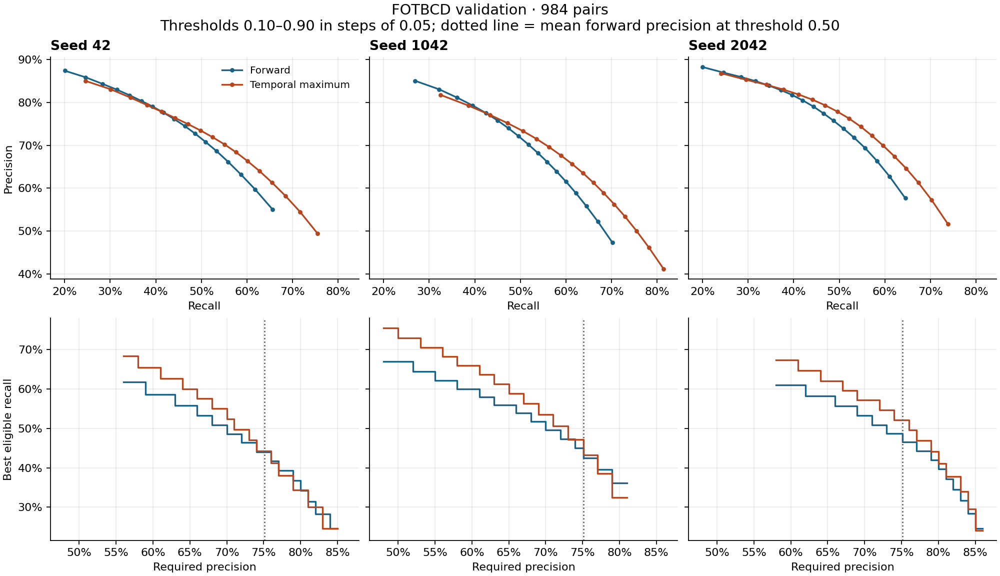

# 사라진 건물 탐지의 시간 결합·임계값 대조

- **결합 효과 확인 기준 미충족.** A+T 대 A-tuned의 프랑스 사라진 건물 R은 3.07배, 평균 F1 차이는 +0.0205였다. seed 42 F1 차이와 짝 bootstrap 95% 구간은 +0.0223 [-0.0007, +0.0467]이다.
- **개선의 출처.** A → A+T의 사라진 건물 recall 증가 29.72%p 중, 임계값을 0.50에 둔 결합이 먼저 설명하는 몫은 70.8%였다. 반대로 순방향 임계값을 먼저 낮추면 그 단계가 17.1%를 설명한다.
- **대가.** A → A+T에서 프랑스 precision은 0.7725 → 0.6295, LEVIR F1은 0.8971 → 0.8618. 쌍당 추론 횟수는 두 배이고, 이 실행의 모델 확률 계산 시간비는 1.98배였다.

## 질문과 검증 순서

이미 이전 시험의 두 칸을 본 뒤 세운 설명용 대조다. 기준 연구 커밋 `c729eb1`에서 `hyh4867/astra-threshold`를 분기하고 [사전등록](../PREREGISTRATION_DIRECTION_CONTROL.md)을 `a1edfaa`에 커밋해 push한 뒤 추론했다. 동결 A는 seed 42, 1042, 2042의 세 가중치다. FOTBCD에서는 이전과 같은 입력 격자에서 순·역 확률을 각각 구하고 원래 라벨 격자로 복원한 뒤 최댓값을 취했다. 모든 임계값은 ≥ 조건이다. [추론·선택 코드](../../scripts/threshold_control.py)

새 대조의 test 점수를 계산하기 전에 원본 가중치·manifest 해시를 검증하고, 각 seed의 기존 A와 A+T를 전량 재추론했다. **5,874개 쌍·seed·구성 행**에서 TP/FP/FN, 신축·사라진 건물의 적중 픽셀과 각 분모가 모두 같았다. 확률을 float32로 임시 저장한 뒤 validation만으로 임계값을 골랐다. 선택을 동결한 커밋 `210c4a1a3b37d0bdc27334d16f9398edbfbd4f44`, 설정 SHA-256 `aa754462ed90a570a316cd3d09e4344e9da23d60e67546ae5142d6aca9b18f04`, 시작 상태 `git_dirty=false`에서 프랑스 979쌍은 저장 확률로 채점하고 LEVIR 128쌍은 전량 추론했다. [재현 계수 확인과 입력 해시](../../outputs/direction_control/reproduction.json) · [동결 설정](../../outputs/direction_control/frozen.json) · [실행 기록](../../outputs/direction_control/final_run.json)

## Validation에서 선택한 두 대조

A-tuned는 순방향 0.30/0.40/0.50 중 세 seed 평균 F1이 가장 높은 임계값 **0.30**를 쓴다. A+T-P의 “같은 precision”은 validation에서 세 seed 평균 precision의 **하한**을 맞추는 뜻으로 해석했다. 유한한 임계값 격자에서 정확한 동률을 강제하지 않았다. validation에서 A의 평균 precision 0.7514 이상을 달성한 최댓값 결합 중 임계값 0.65가 최고 recall을 냈다(P 0.7618, R 0.4730). test에서 A+T-P의 P는 0.7789, A의 P는 0.7725였다. 사라진 건물 R은 각각 0.2263, 0.0684였다. test precision의 실제 차이는 +0.0064이다.

| 순방향 임계값 | validation F1 | precision | recall |
|---|---|---|---|
| 0.3 | 0.6064 | 0.6735 | 0.5552 |
| 0.4 | 0.5939 | 0.7155 | 0.5108 |
| 0.5 | 0.5739 | 0.7514 | 0.4669 |

아래 그림의 윗줄은 실제 임계값 17개에서 잰 PR이다. 아랫줄은 두 방식이 모두 포괄하는 precision 범위에서 같은 precision 하한을 만족하는 격자점의 최대 recall을 보여 준다. 점선은 A의 평균 validation precision이다. [seed별 전체 PR 계수](../../outputs/direction_control/validation_pr.csv) · [precision 하한별 값](../../outputs/direction_control/matched_precision_curve.csv)



## 프랑스 2×2와 추가 대조

쌍별 정수 계수를 먼저 seed 안에서 모두 합산해 지표를 구한 뒤 세 seed 점수를 동일 가중 평균했다. 별칭이 같은 설정을 가리키면 동일 마스크를 재사용했다. 방향별 R은 이진 변화 예측이 전체판 신축 또는 사라진 건물 폴리곤의 픽셀을 덮은 비율이다. LEVIR는 이진 정답만 있으므로 방향별 값을 계산하지 않았다.

| 구성 | 임계값 | FOTBCD F1 | P | R | 신축 R | 사라진 건물 R | LEVIR F1 | LEVIR P | LEVIR R |
|---|---|---|---|---|---|---|---|---|---|
| 순방향 0.50 (A) | 0.50 | 0.5397 | 0.7725 | 0.4165 | 0.5152 | 0.0684 | 0.8971 | 0.9278 | 0.8685 |
| 순방향 0.30 | 0.30 | 0.5711 | 0.6952 | 0.4873 | 0.5917 | 0.1191 | 0.8935 | 0.8626 | 0.9268 |
| 최댓값 0.50 | 0.50 | 0.5749 | 0.7217 | 0.4815 | 0.5376 | 0.2788 | 0.8841 | 0.8903 | 0.8782 |
| 최댓값 0.30 (A+T) | 0.30 | 0.5916 | 0.6295 | 0.5635 | 0.6190 | 0.3655 | 0.8618 | 0.7982 | 0.9366 |
| A-tuned | 0.30 | 0.5711 | 0.6952 | 0.4873 | 0.5917 | 0.1191 | 0.8935 | 0.8626 | 0.9268 |
| A+T-P | 0.65 | 0.5430 | 0.7789 | 0.4194 | 0.4728 | 0.2263 | 0.8724 | 0.9332 | 0.8191 |

[세 seed 평균](../../outputs/direction_control/means.csv) · [각 seed의 전체 지표와 계수](../../outputs/direction_control/scores.csv) · [프랑스 쌍별 계수](../../outputs/direction_control/fotbcd_counts.csv) · [LEVIR 쌍별 계수](../../outputs/direction_control/levir_counts.csv)

### 같은 조건에서 한 요소만 바꾼 효과

아래는 절대 지표 차이이다. 결합 효과는 최댓값−순방향, 임계값 효과는 0.30−0.50이다. 상호작용은 ‘0.30에서 결합 효과’에서 ‘0.50에서 결합 효과’를 뺀 값이다.

| 대조 | 프랑스 ΔF1 | ΔP | Δ사라진 건물 R | LEVIR ΔF1 |
|---|---|---|---|---|
| 결합 효과 · 0.50 고정 | +0.0351 | -0.0508 | +0.2104 | -0.0130 |
| 결합 효과 · 0.30 고정 | +0.0205 | -0.0658 | +0.2464 | -0.0317 |
| 임계값 효과 · 순방향 고정 | +0.0314 | -0.0773 | +0.0507 | -0.0036 |
| 임계값 효과 · 최댓값 고정 | +0.0168 | -0.0922 | +0.0868 | -0.0224 |
| 상호작용 | -0.0146 | -0.0149 | +0.0361 | -0.0187 |
| 함께 변경 | +0.0519 | -0.1430 | +0.2972 | -0.0353 |
| A+T − A-tuned | +0.0205 | -0.0658 | +0.2464 | -0.0317 |
| A+T-P − A | +0.0033 | +0.0064 | +0.1579 | -0.0247 |

사라진 건물 recall을 기준으로 결합을 먼저 적용한 경로는 **결합 70.8% + 임계값 29.2%**였다. 임계값을 먼저 바꾼 경로는 **임계값 17.1% + 결합 82.9%**였다. 두 경로는 같은 시작·끝 칸을 잇는다. 이 몫은 변경 순서에 따라 달라지며, 한 데이터셋에서 관측한 검출 규칙의 분해다. [대조별 지표 차이](../../outputs/direction_control/contrasts.csv) · [경로별 몫](../../outputs/direction_control/path_fractions.json)

### seed별 확인과 짝 bootstrap

| 구성 | 프랑스 F1 (42/1042/2042) | 사라진 건물 R (같은 순서) | LEVIR F1 (같은 순서) |
|---|---|---|---|
| 순방향 0.50 (A) | 0.5320 / 0.5585 / 0.5286 | 0.0671 / 0.0734 / 0.0646 | 0.8957 / 0.8977 / 0.8979 |
| 순방향 0.30 | 0.5704 / 0.5767 / 0.5662 | 0.1157 / 0.1325 / 0.1090 | 0.8967 / 0.8889 / 0.8949 |
| 최댓값 0.50 | 0.5666 / 0.5885 / 0.5694 | 0.2421 / 0.3533 / 0.2409 | 0.8850 / 0.8817 / 0.8857 |
| 최댓값 0.30 (A+T) | 0.5927 / 0.5872 / 0.5950 | 0.3358 / 0.4440 / 0.3168 | 0.8688 / 0.8526 / 0.8639 |
| A-tuned | 0.5704 / 0.5767 / 0.5662 | 0.1157 / 0.1325 / 0.1090 | 0.8967 / 0.8889 / 0.8949 |
| A+T-P | 0.5285 / 0.5680 / 0.5325 | 0.1927 / 0.2869 / 0.1992 | 0.8692 / 0.8736 / 0.8744 |

seed 42 안에서 같은 쌍을 함께 복원추출하고 픽셀 계수를 다시 합산해 구한 차이 [95% 구간]이다(B=1,000). 쌍 단위 구간은 지역의 공간 상관이나 학습 seed 불확실성을 보정하지 않는다.

| 비교 | 프랑스 ΔF1 | 프랑스 Δ사라진 건물 R | LEVIR ΔF1 |
|---|---|---|---|
| 결합 효과 · 0.50 고정 | +0.0346 [+0.0140, +0.0565] | +0.1750 [+0.0980, +0.2597] | -0.0107 [-0.0140, -0.0082] |
| 결합 효과 · 0.30 고정 | +0.0223 [-0.0007, +0.0467] | +0.2201 [+0.1383, +0.3097] | -0.0278 [-0.0334, -0.0236] |
| 임계값 효과 · 순방향 고정 | +0.0384 [+0.0286, +0.0488] | +0.0486 [+0.0332, +0.0682] | +0.0009 [-0.0022, +0.0039] |
| 임계값 효과 · 최댓값 고정 | +0.0261 [+0.0127, +0.0402] | +0.0937 [+0.0661, +0.1241] | -0.0162 [-0.0199, -0.0126] |
| 상호작용 | -0.0123 [-0.0191, -0.0046] | +0.0451 [+0.0235, +0.0673] | -0.0171 [-0.0197, -0.0148] |
| 함께 변경 | +0.0607 [+0.0337, +0.0901] | +0.2687 [+0.1822, +0.3638] | -0.0269 [-0.0328, -0.0215] |
| A+T − A-tuned | +0.0223 [-0.0007, +0.0467] | +0.2201 [+0.1383, +0.3097] | -0.0278 [-0.0334, -0.0236] |
| A+T-P − A | -0.0035 [-0.0231, +0.0175] | +0.1256 [+0.0575, +0.2055] | -0.0265 [-0.0292, -0.0240] |

[모든 지표의 seed 42 구간](../../outputs/direction_control/bootstrap.csv) · [계산 코드](../../scripts/analyze_threshold_control.py)

사라진 건물 recall의 배수와 3 seed 평균 F1은 주 기준을 넘었지만, seed 42 F1 차이의 구간은 0을 포함했다. 따라서 관측된 방향별 재현율 이득과 F1 개선의 통계적 판정을 구분한다.

## 예측 대 실제

| 항목 | 작업 에이전트 사전 예측 | Claude 독립 예측 | 실측 | 작업 / Claude |
|---|---|---|---|---|
| 순방향 0.30 F1 | 0.555 (0.53–0.58) | 0.56 (0.54–0.58) | 0.5711 | 충족 / 충족 |
| 순방향 0.30 사라진 건물 R | 0.11 (0.08–0.15) | 0.10 (0.07–0.15) | 0.1191 | 충족 / 충족 |
| 최댓값 0.50 F1 | 0.58 (0.55–0.61) | 0.58 (0.56–0.60) | 0.5749 | 충족 / 충족 |
| 최댓값 0.50 사라진 건물 R | 0.27 (0.20–0.34) | 0.30 (0.22–0.38) | 0.2788 | 충족 / 충족 |
| 0.50에서 결합 몫 | 68% (50–83%) | ≥70% | 70.8% | 충족 / 충족 |
| A+T-P 사라진 건물 R | 0.20 (0.12–0.30) | 0.25 (0.15–0.35) | 0.2263 | 충족 / 충족 |

## 검산·한계와 사이트 문구

표준 라이브러리만 사용하는 별도 스크립트가 두 데이터셋의 36개 F1을 정수 TP/FP/FN으로 재합산했다. 최대 절대 차이는 0이다. [독립 계산](../../scripts/verify_threshold_control.py) · [검산 결과](../../outputs/direction_control/independent_f1.json)

측정 단위는 프랑스 2,937개 쌍·seed이다. 순방향 확률 계산 72.3초, 역방향 및 최댓값 추가 70.7초, 양방향 합계 143.0초였다. GPU 결과를 CPU로 가져온 뒤 시간을 읽었다. 시간에는 모델 호출과 확률 격자 복원이 들어가며, 파일 읽기·모델 로드·라벨 채점은 제외했다. 순방향을 먼저 호출하는 순서와 공유 기기의 부하도 실측 비율에 영향을 줄 수 있다. [쌍별 시간](../../outputs/direction_control/fotbcd_inference_time.csv) · [시간 합계](../../outputs/direction_control/timing.json)

이전 연구와 겹치는 validation 12개 운영점에서도 TP/FP/FN이 모두 일치했다. 그림 생성 시 시스템 Python의 NumPy가 없어 같은 Matplotlib 3.9.2를 독립된 실행 환경에서 사용했다. 추론·선택·판정 규칙은 그대로 적용했다. 각 긴 단계는 screen과 caffeinate -i로 실행했고, 스왑·메모리 조건을 확인했다. 완료 후 ASTRA 대조 실험의 screen 세션과 추론 프로세스가 모두 종료됐음을 확인했다.

기존 프랑스 공식 시험을 재사용했으므로 새 지역에서 독립적으로 확인된 효과는 아니다. A+T-P의 precision 하한도 validation에서만 보장된다. 기존 산출물·가중치를 유지하고 새 결과는 direction_control에 보존했다.

**사이트 문구 제안** — “프랑스 FOTBCD에서 양방향 최댓값과 임계값 0.30을 사용하면 기존 순방향 0.50 대비 사라진 건물 픽셀 재현율이 6.8%에서 36.6%로 올랐습니다. 임계값을 0.50에 둔 채 양방향 결합만 적용해도 사라진 건물 재현율은 27.9%였습니다. 프랑스 전체 F1은 0.540에서 0.592로 올랐고, precision은 0.773에서 0.629로, LEVIR F1은 0.897에서 0.862로 내려갔습니다. 두 방향을 계산해 추론 시간은 약 2배였습니다(실측 1.98배).”

## 전체 pytest 출력

`python -m pytest -ra --tb=short tests` 출력이다. 로컬 경로 접두어만 상대 경로로 표시했다.

```text
============================= test session starts ==============================
platform darwin -- Python 3.12.8, pytest-8.4.2, pluggy-1.7.0
rootdir: .
plugins: anyio-4.16.0
collected 54 items

tests/test_detector.py ..                                                [  3%]
tests/test_direction.py ....                                             [ 11%]
tests/test_generalization.py .....                                       [ 20%]
tests/test_geospatial.py ....                                            [ 27%]
tests/test_inference.py .....s                                           [ 38%]
tests/test_registration.py ...............................               [ 96%]
tests/test_threshold_control.py ..                                       [100%]

=============================== warnings summary ===============================
tests/test_inference.py::test_streamlit_app_smoke_on_synthetic_pair[TinyCD]
  ./.venv/lib/python3.12/site-packages/torchvision/models/_utils.py:207: UserWarning: The parameter 'pretrained' is deprecated since 0.13 and may be removed in the future, please use 'weights' instead.
    warnings.warn(

tests/test_inference.py::test_streamlit_app_smoke_on_synthetic_pair[TinyCD]
  ./.venv/lib/python3.12/site-packages/torchvision/models/_utils.py:222: UserWarning: Arguments other than a weight enum or `None` for 'weights' are deprecated since 0.13 and may be removed in the future. The current behavior is equivalent to passing `weights=None`.
    warnings.warn(msg)

-- Docs: https://docs.pytest.org/en/stable/how-to/capture-warnings.html
=========================== short test summary info ============================
SKIPPED [1] tests/test_inference.py:64: Optional ROBUST checkpoint and readiness marker required
================== 53 passed, 1 skipped, 2 warnings in 9.82s ===================
```
